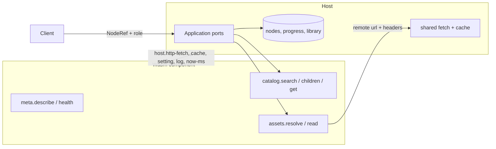

# EMMA plugin contract (`emma:core@1.0.0`)

Status: **v1 contract agreed in principle** (phase 1; owner decisions in section 11).
Two small questions remain open (facets, rating scale). Nothing implements this yet.

Sources of truth, all under `src/EMMA.Contracts/`:

| File | What it defines |
| --- | --- |
| `wit/types.wit` | `node`, `prop`, `query`, filters, errors, paging |
| `wit/host.wit` | what a plugin may ask of the host (`http-fetch`, cache, settings, log, clock) |
| `wit/meta.wit` | `describe()` (kinds, filters, sorts, settings) and `health()` |
| `wit/catalog.wit` | `search`, `children`, `get` |
| `wit/assets.wit` | `resolve`, `read` |
| `wit/search-assist.wit` | the first **optional** extension (`suggest`, `enrich`) |
| `wit/world.wit` | worlds `plugin` (base) and `plugin-search-assist` |
| `plugin-manifest.schema.json` | the signed manifest (identity, trust, limits) |

Both worlds were validated with `wit-bindgen rust` (0.45) and the manifest patterns were
exercised against accept/reject cases. Run the same check after any edit:

```sh
cd src/EMMA.Contracts
wit-bindgen rust wit --world plugin --out-dir "$TMPDIR/p"
wit-bindgen rust wit --world plugin-search-assist --out-dir "$TMPDIR/s"
```

## 1. Why the old core needed constant additions

`main` modelled each media type as its own protocol: `PageProvider`, `VideoProvider`,
`/pipeline/paged`, `/pipeline/video`, separate progress records, SQL tables, download
branches and native exports. Adding audio would have touched 15 to 20 places. The same
accretion showed up inside types: an `Attributes` JSON string, `args-json`/`payload-json`
on every call, `uploader_groups` (a scanlation concept) inside the chapter model, and
`_v2`/`_v3` FFI exports.

The cause is one decision: **the contract described the shape of the media instead of the
shape of a tree of things.** Manga is media, then chapter, then page. Video is media, then
stream, then segment. Both are a tree that ends in bytes, and so is everything else EMMA
will aggregate.

## 2. The model in one paragraph

A plugin serves a **tree of nodes**. A node has a plugin-local `id`, an open-string `kind`,
a `title`, an optional `parent`, an optional `thumbnail` and typed `props`. The host reads
the tree with three calls (`search`, `children`, `get`). A leaf (or any node) is turned into
bytes with one call, `resolve(node, role)`, which returns one or more **assets**: a mime
type, a delivery (inline, remote URL with headers, or plugin-proxied) and typed props. A
plugin declares its kinds, the child kinds each may have, and the roles each can resolve in
`describe()`. That declaration is the schema, so generic clients navigate any plugin
without plugin-specific code.



## 3. Design rules

1. **No media types in the contract.** `kind` is an open string. Nothing in the core
   switches on it. The only place a kind is interpreted is a client, through a profile.
2. **Identity belongs to the host.** Plugins only see and return plugin-local ids. The host
   owns the pair `NodeRef(pluginId, localId)`, so collisions between plugins are impossible
   and `main`'s `MediaId` / `SourceId` / `PluginId` / `ExternalId` confusion disappears.
   Canonical text form is `{pluginId}:{localId}`; plugin ids cannot contain `:` (the
   manifest pattern forbids it), so the first `:` always splits correctly.
3. **Records are frozen; growth goes through `props` and optional interfaces.** A WIT
   record cannot gain a field without breaking every compiled plugin. So the base contract
   is small, closed and rarely changes, and new data is carried by:
   - the `props` vocabulary (typed, no JSON escape hatch), and
   - **optional extension interfaces**, each in its own world that `include`s `plugin`.
4. **Bytes move by reference.** The preferred delivery is `remote(url, headers)`: the host
   fetches it, so bytes never cross the plugin boundary and one cache serves every plugin.
   `proxied(token)` plus `read` exists only for assets that only the plugin can read
   (signed requests, decryption). `inline` is for tiny payloads.
5. **The manifest is trust, `describe()` is truth.** Identity, limits, permissions and
   signature live in the signed manifest and are read before any code runs. What the plugin
   serves comes from the running code, so it cannot drift. The manifest's display-only
   `kinds` list is validated against `describe()` at install and load.
6. **The host is the plugin's whole world.** No filesystem, sockets or ambient clock are
   provided. Network, cache and settings are explicit host calls, gated by the manifest.

## 4. Kinds and profiles

`describe()` returns a `kind-info` per kind: its label, the child kinds allowed beneath it
(empty means leaf), and the asset roles it can resolve. `profile` optionally names a client
profile. A **profile** is a published vocabulary (kinds, roles, well-known props) that a
client can build a typed experience on. Profiles are documentation plus host-side
validation, not WIT. They cost nothing in the core.

### Well-known `emma.*` props

Keys starting `emma.` are reserved. Plugin-specific data uses the author's own prefix.

| Key | Type | Meaning |
| --- | --- | --- |
| `emma.synopsis` | text | Description |
| `emma.rating` | number | 0 to 10 |
| `emma.tags` | text-list | Genres and tags |
| `emma.language` | text | BCP 47 tag |
| `emma.ordinal` | number | Position label such as chapter 12.5 or episode 3 (display; order is the returned order) |
| `emma.released-ms` | timestamp-ms | Release or publish time |
| `emma.creators` | text-list | Authors, artists, directors |
| `emma.status` | text | `ongoing`, `completed`, `hiatus`, `cancelled` |
| `emma.groups` | text-list | Uploader or scanlation groups (this replaces `uploader_groups` in the core) |
| `emma.duration-ms` | integer | Playback length |
| `emma.reading-direction` | text | `ltr`, `rtl`, `vertical` |

Asset props: `emma.quality`, `emma.language`, `emma.width`, `emma.height`, `emma.live`,
`emma.default`, `emma.drm.scheme`, `emma.drm.license-url`.

### Profiles defined for v1

| Profile | Shape | Roles |
| --- | --- | --- |
| `emma.profile.paged@1` | container kinds (series, chapter) ending in leaf page nodes, children in reading order | `image` (mime `image/*`) |
| `emma.profile.video@1` | container kinds (series, season) ending in playable nodes | `stream` (an adaptive manifest or a direct file), optional `subtitle`, `audio` |
| `emma.profile.audio@1` | album or show ending in track nodes | `audio` |
| `emma.profile.text@1` | book or feed ending in article or chapter nodes | `text` (`text/html` or `text/markdown`) |

Only the first two exist in `main`. The other two are listed to prove the model needs no
core change; they are not built in v1.

## 5. Capabilities, versioning and optional packs

- The **component's exports are authoritative**. The host instantiates the component and
  inspects its exports. The manifest's `contract` block is a declaration the host checks
  against reality, so there is no separate handshake or version negotiation to drift.
- Interface ids carry a **major** version (`emma:core/catalog@1`). Within a major version
  nothing breaks.
- **Optional features are interfaces outside the base world.** `search-assist` is the
  first and the template: a new interface, a new world that does `include plugin;`, its own
  version. A plugin opts in by targeting that world. The host works without it.
- Resulting growth rule: the base world is a major-version event to change. Everything else
  is an optional interface or a new `emma.*` prop.

Whether media-type behavior ever needs optional WIT interfaces is an open question (see
section 11). Section 6 shows `main` needs none.

## 6. Mapping from `main`

| `main` concept | New contract |
| --- | --- |
| `MediaMetadata`, `MediaSummary` | `node` (`kind` = series, `emma.synopsis`, `emma.rating`, `emma.tags`, ...) |
| `MediaType` enum (`Paged`/`Video`/`Audio`) | `kind` string plus an optional profile |
| `MediaChapter` (id, number, title, `uploader_groups`) | child `node` of kind `*.chapter`; `emma.ordinal`; `emma.groups` |
| `GetChapters` | `catalog.children(series, ...)` |
| `MediaPage` (id, index, `content_uri`) | leaf `node` of kind `*.page`; the URL is an asset |
| `GetPage`, `GetPages(start, count)`, `reached_end` | `children(chapter, {cursor, limit})`, then `resolve(page, "image")`; absent `next-cursor` is `reached_end` |
| `GetPageAsset`, `IPageAssetFetcherPort`, page asset cache | `resolve` returns `remote`; the host's shared fetch and cache path serves it |
| `StreamInfo` (`playlist_uri`, headers, cookies) | `asset` with `remote(url, headers)`; cookies are a `Cookie` header |
| `is_live`, `stream_type` | `emma.live`, and the manifest `mime` |
| `drm_protected`, `drm_scheme` | `emma.drm.scheme`, `emma.drm.license-url` |
| audio and subtitle tracks, default track ids | extra assets for roles `audio`/`subtitle`, told apart by `emma.language`; `emma.default` |
| `GetSegment` (bytes through gRPC or base64 JSON) | removed: the client player reads the adaptive manifest; plugin-only data uses `proxied` plus `read` (raw bytes) |
| `Search` (query only reaches the plugin) | `catalog.search(query)` with kinds, typed filters, sort, cursor |
| `SearchSuggestions`, `EnrichSearchItems` | optional `search-assist.suggest` and `enrich` |
| manifest `SearchExperience.Filters` | `meta.describe().filters` (`filter-spec`), including ranges and lookups |
| manifest `SearchExperience.Landing` | `catalog.children(none, ...)`: section nodes the client expands. Landing templates, titles and subtitles were UI decoration and are dropped (client concern) |
| manifest `Query.Additions` (prefix/suffix tokens) | ordinary filters |
| `GetCapabilities`, `PluginCapabilityProfile` enum | the component's exports plus `describe()`; no enum |
| `GetHealth` | `meta.health()` |
| `Capabilities.CpuBudgetMs/MemoryMb` | manifest `limits` |
| `Capabilities.Network`, `Permissions.Domains` | manifest `permissions.network` |
| `Permissions.Paths`, `Capabilities.FileSystem` | dropped: a Wasm plugin has no filesystem |
| `Capabilities.Cache` | manifest `permissions.cache` plus `host.cache-*` |
| `Protocol`, `Endpoint` | dropped; `transport` is `wasm` (reserved `process` for the deferred out-of-process mode) |
| WIT `invoke`, `args-json`, `payload-json`, `host-bridge.*-payload` | removed: typed calls only; the host-bridge is `host.http-fetch` |
| `IProgressPort` (paged and video pairs), history `position` | host-side `Progress` (section 8) |
| `DownloadJobRecord(ChapterId?, StreamId?)` | host-side generic job over `(NodeRef, role, hints)` (section 8) |

Dropped on purpose: handshake and version negotiation, the capability-profile enum, the
generic `invoke` escape hatch, per-type native exports, media-type fields in storage.

## 7. Worked examples

Each fits with no core change. The first two are `main`'s existing types; the third is a
type the old core could not express without new RPCs.

**Manga plugin** (`emma.profile.paged@1`)

```text
kinds:   manga            children [manga.chapter]
         manga.chapter    children [manga.page]            (roles: none)
         manga.page       children []   roles [image]
search("berserk")                    -> [node manga  id="b1"  title="Berserk"  props{emma.synopsis, emma.tags}]
children("b1")                       -> [node manga.chapter id="b1-c1" props{emma.ordinal 1, emma.groups [..]}, ...]
children("b1-c1", {limit 50})        -> [node manga.page id="b1-c1-p1", ...]   next-cursor present if more
resolve("b1-c1-p1", "image")         -> [asset image/jpeg remote(url, headers{Referer})]
```

**Video plugin** (`emma.profile.video@1`)

```text
kinds:   series  children [season]   |  season children [episode]  |  episode roles [stream, subtitle]
resolve("ep1", "stream", hints{emma.quality "1080p"})
  -> [asset application/vnd.apple.mpegurl remote(url, headers) props{emma.live false, emma.drm.scheme none}]
resolve("ep1", "subtitle") -> [asset text/vtt remote(..) props{emma.language "ja"}, asset text/vtt ... {"en", emma.default true}]
```

**Recipe plugin** (no profile; a kind that does not exist anywhere in EMMA)

```text
kinds:   recipe  children [recipe.step]   roles [image]
         recipe.step  children []  roles [text, image]
search("lasagna", kinds ["recipe"]) -> [node recipe id="r9" props{acme.servings 6, emma.duration-ms 5400000}]
children("r9")                      -> [node recipe.step ...]
resolve("r9-s2", "text")            -> [asset text/markdown inline(bytes)]
```

A generic client already lists, searches, shows props, tracks progress and downloads the
recipe; only a *rendering* of `recipe` needs new client code.

## 8. Host-side domain (not WIT)

These live in `EMMA.Domain` / `EMMA.Application` and are never seen by plugins.

- `NodeRef(PluginId, LocalId)`: the only node identity the host and clients use.
- `Progress(NodeRef, Locator{Unit, Value, Total?}, Completed, UpdatedAt)`. `Unit` is an open
  string (`page`, `ms`, `paragraph`). For paged media the progress node is the *chapter* with
  unit `page`; for video, the episode with unit `ms`. "Continue reading" for a series is a
  query for the most recently progressed descendant. This replaces the two typed progress
  records and the single `position REAL`.
- `Library` entries and history reference `NodeRef` only.
- **Downloads** are a job over `(NodeRef, role, hints)`: the host walks `children` down to
  nodes whose kind declares the role, resolves each, and stores the assets. One executor, no
  paged or video branch.
- **Storage** (built in phase 3, SQLite with STRICT tables): `nodes` keyed `(plugin_id, local_id)`
  with `kind`, `title`, `parent_local_id`, `thumbnail` and `props` (typed JSON through a
  source-generated context); `progress` and `library` keyed by user plus the same pair;
  `download_jobs`. Migrations are scripts under `src/EMMA.Storage/Sql/`. There is no assets table
  (asset bytes live in the bounded cache) and no foreign key from user state to `nodes`: nodes are
  a cache that may be purged, while progress and library entries must survive that.
- All timestamps come from an injected `IClock`; plugins use `host.now-ms`.

## 9. Limits the host enforces

A response that breaks a limit is rejected as `internal` and logged against the plugin.
The numbers are proposals to be fixed in phase 4.

| Item | Limit |
| --- | --- |
| node `id` | 512 UTF-8 bytes |
| `title` | 1024 UTF-8 bytes |
| props per node, key length | 64, 128 chars |
| nodes per page | 500 |
| cursor | 2048 bytes |
| inline asset | 1 MiB |
| nodes of an undeclared `kind` | rejected |

## 10. Risks to check early

These are things I could not settle on paper. Each gets a time-boxed spike before the phase
that depends on it.

1. **Optional export probing (phase 5).** The design relies on the host instantiating a
   component and detecting `search-assist` by export name, using bindings generated for the
   base world. Needs a spike with wasmtime 34 `component::bindgen!`. The fallback is
   generating bindings for each world and trying them in order.
2. **Semver matching of interface ids (phase 5).** Plugins built against `@1.0.0` must run
   on a host built against `@1.0.x`. Confirm wasmtime resolves compatible versions for
   exports as it does for imports.
3. **`host.http-fetch` is a blocking call from the guest's view.** CPU budgeting must not
   count time spent waiting inside the host, and each call needs its own timeout. Needs
   design in phase 5.
4. **Large `list<u8>` copies.** `inline` and `read` copy across the boundary. That is fine
   for the intended sizes and is why `remote` is preferred; measure once a real plugin exists.
5. **Extension packs in separate WIT packages.** `search-assist` lives inside
   `emma:core` for now because separate packages need dependency vendoring. Revisit when a
   second, independently versioned pack appears.
6. **No WIT toolchain validator beyond `wit-bindgen`.** `wasm-tools` is not installed here;
   `wit-bindgen` parses and type-checks, which is enough for phase 1. CI in phase 5 should
   use `wasm-tools component wit`.

## 11. Decisions and open questions

Decided by the owner (2026-11-07):

1. **Media-type packs are profiles; WIT extensions are for behavior.** Section 6 shows every
   behavior in `main` fits `children` plus `resolve`, so `emma:paged` / `emma:video` WIT
   interfaces would have no functions to carry. Paged, video, audio and text are published
   profiles (vocabulary plus host validation). Optional WIT interfaces are reserved for new
   behavior, with `search-assist` as the working example. Revisit if a media type ever needs
   a call that `children`/`resolve` cannot express.
2. **Settings and secrets stay in v1** (`host.setting`, `setting-spec`). Records are frozen,
   so adding them later would be a major version.
3. **`proxied` assets and `read` stay in v1**, as the escape for content only the plugin can
   read.
4. **Landing pages are `children(none)`**; plugin landing templates, titles and subtitles
   are dropped as a client concern.

Still open (small; defaults apply unless changed):

5. **Facets in search results.** Kept as an optional list in `node-page`. Drop if no plugin
   will provide them.
6. **Rating scale.** `emma.rating` is 0 to 10 as a number (`main` used a string).
