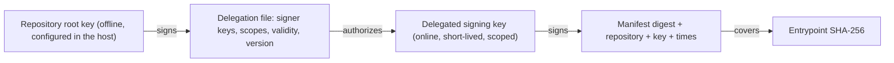

# Plugin trust, signing and installation

Status: implemented in `EMMA.PluginHost` (phase 4). The plugin-facing contract is
`docs/architecture/contract.md`; this document is about deciding whether to run a plugin at all.

## The model

A plugin package is a zip holding exactly two files: `plugin.json` and the one component named by its
`entrypoint`. The host installs it only if a chain of signatures leads from a key it already trusts to
that exact component.

- **Root keys** live in the host's `TrustPolicy`, one set per trusted repository. They sign only delegation files.
- **A delegation file** lists the delegated keys, each with a status (`ACTIVE`, `RETIRED`, `REVOKED`), a validity
  window and **scopes**: an exact plugin id, or `prefix.*` for everything under a prefix. Scopes match whole
  segments, so `com.acme.*` covers `com.acme.manga` but not `com.acmevil.manga`.
- **A delegated key** signs plugins. Compromising it affects only its scopes, and revoking it needs a new
  delegation file, not re-signing the repository.
- **The signature** covers the manifest digest, the repository id, the key id and both timestamps. The manifest
  digest covers every manifest field, including the entrypoint's SHA-256, so the signature covers the code.

## What is signed, exactly

Signed bytes are built by `FrameWriter`: every value is a one-byte type tag plus, for variable-size values, a
four-byte length. One field can never be read as part of another. Each payload starts with its own domain tag
(`EMMA-MANIFEST/1`, `EMMA-PLUGIN-SIGNATURE/1`, `EMMA-DELEGATION/1`), so a signature made for one purpose cannot be
replayed as another. The manifest digest is computed from the **parsed fields in a fixed order**, never from the
JSON text, and the parser rejects unknown and repeated properties, so nothing unsigned can ride along. A test
changes every manifest field in turn and fails if one does not change the digest, so a field added later cannot
be left unsigned by accident.

## Verification, in order

`PluginSignatureVerifier.VerifyAsync(manifest, repositoryId)` rejects, with a specific reason, unless all hold:

1. The manifest has a signature, and it names the repository the package **actually came from** (supplied by the
   host, not read from the manifest to locate anything).
2. That repository is in the trust policy.
3. The signature is not dated in the future (5 minutes of skew allowed) and has not expired.
4. The manifest digest recomputed now equals the one the signer recorded (the manifest was not changed).
5. The repository's delegation file loads, parses strictly, names this repository, was signed by a trusted root
   key, and is not dated in the future.
6. Its version is not lower than one already accepted (`IDelegationVersionPort`). This runs only after the root
   signature verified, so forged files cannot move the counter.
7. The signing key is delegated, not `REVOKED`, was valid when it signed, and one of its scopes covers the plugin id.
8. The RSA PKCS#1 v1.5 SHA-256 signature verifies. Keys must be `PUBLIC KEY` blocks of at least 2048 bits.

## Installation

`PluginPackageInstaller.InstallAsync(package, repositoryId)`:

1. Structural checks before anything is read: at most 64 entries, every name a plain relative path compared by whole
   segments, no duplicates (ignoring case), no symbolic links, declared sizes within limits.
2. Strict manifest parse, then the signature check. A present signature must verify even when unsigned plugins are
   allowed. An unsigned plugin is accepted only when `TrustPolicy.RequireSigned` is false.
3. The package may contain only `plugin.json` and the entrypoint.
4. A downgrade (older semantic version than installed) and a repeat of the same version are refused.
5. The entrypoint is copied to a staging directory while hashed (bytes counted as actually read, not as declared); the
   hash must equal the manifest's.
6. One directory move installs it atomically as `{InstallRoot}/{id}/{version}/`, then the registry record is written.
   If that fails, the files are removed, so nothing is half-installed.

`ManifestCapabilityPolicyProvider` then grants the plugin exactly the network hosts and cache permission in its
verified manifest, and nothing to a plugin that is unknown, disabled, quarantined or has an unreadable manifest.

## What changed from `main`, and why

| `main` | Now |
| --- | --- |
| Delegation file path built from the `repositoryId` inside the manifest's own signature block (path traversal) | The repository id comes from the package source and must be a plain identifier; `FileDelegationSource` rejects anything else |
| Signed text was `key=value` lines joined with `\n` | Length-prefixed binary frames with domain tags |
| Payload digest was optional; the signature might not cover the code | The entrypoint digest is mandatory and part of the signed manifest digest |
| Scopes matched by raw string prefix (`com.acme*` covered `com.acmevil.x`) | Whole-segment matching (`com.acme.*`) |
| Zip-slip check by string prefix without a separator | Names validated as whole-segment relative paths, destination checked by relative path |
| An old validly signed delegation file could be replayed | Persisted per-repository version counter |
| Signature checks could be switched off by environment variable | The library reads no environment; the host passes the policy in |
| `HmacPluginSignatureVerifier` wrapped an RSA verifier | Removed; there is no HMAC anywhere |
| Any extra file in a package was extracted | Only `plugin.json` and the entrypoint are allowed |
| Time from `DateTimeOffset.UtcNow` | Injected `TimeProvider` |

## Not done here

- **Out-of-process plugins and sandboxes**: deferred behind the `IPluginInstance` seam; see [plugin-instance.md](plugin-instance.md).
- **Key ceremony tooling**: creating root and delegated keys, publishing and rotating delegation files. `PluginSigner`
  is the building block; the CLI is phase 8.
- **Fetching** delegation files and packages from a remote repository: the verifier takes an `IDelegationSource`
  and the installer a `Stream`; the HTTP side is the host's.
- **Verification on load** is done: `PluginLoader` re-parses the stored manifest, re-verifies the signature and
  re-hashes the entrypoint before every load, so an expired signature or a revoked key stops a plugin that was
  installed earlier. A changed file quarantines the plugin; a failed signature only refuses the load.
- **A signature expiry policy** (maximum lifetime) is not enforced; signers choose `expiresAt`.
